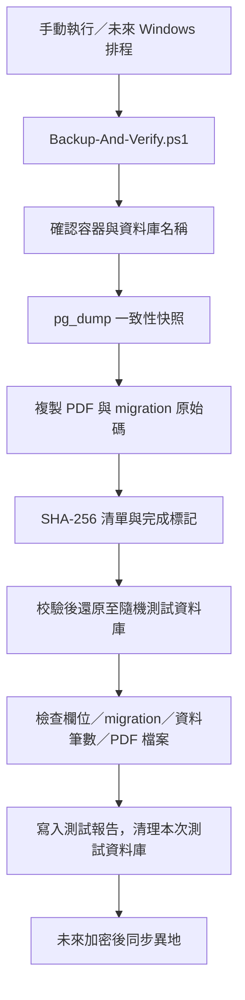

# rag-yt 資料備份與還原設計

本文件以 Windows、Docker PostgreSQL 16 與目前專案為基礎。第一階段採本機備份，異地副本之後再接。本文中的「建議」與「待實作」並不代表已啟用。

## 1. 已完成與目前限制

已提供並實際執行：

- `scripts/backup/Backup-Local.ps1`：一致性資料庫備份、PDF 原檔複製、migration 原始碼、SHA-256 清單。
- `scripts/backup/Test-Backup.ps1`：校驗檔案並實際還原到隨機建立的測試資料庫，驗證後刪除該測試庫。
- `scripts/backup/Backup-And-Verify.ps1`：串接前兩步，供手動執行或排程呼叫。
- 首份備份已通過測試：690 筆逐字稿、62,306 個逐字稿片段、4,881 個 RAG 切塊、1 個 PDF 來源；676 筆逐字稿有處理耗時，14 筆原本為 NULL。這是該份快照的數量，不是之後每次必須相同的固定值。

尚未啟用：Windows 排程、自動清理、異地同步、備份加密、WAL 歸檔、PITR、遷移前強制備份閘門、失敗通知與應用程式層還原測試。現有 API 啟動時仍會執行 `Database.Migrate()`，本次未修改服務啟動行為。

本機備份預設放在專案下的 `backups/`，已加入 `.gitignore`。同一顆磁碟上的備份可應付誤操作，但不能應付磁碟損壞、失竊或整機勒索攻擊；本階段還不是完整異地備援。

## 2. 原理與備份範圍

### PostgreSQL 一致性快照

使用 PostgreSQL 容器內的 `pg_dump --format=custom`。它在讀取時取得一致性快照，包含這個應用資料庫的結構、資料、索引、約束、序列與 EF migration 歷史。備份期間一般資料庫讀寫可以繼續。

備份不是直接複製正在運作的 Docker volume，也不是把 SQL 查詢結果或原始二進位資料經 PowerShell 管線輸出。dump 先寫入容器暫存檔，再以 `docker cp` 複製，避免 Windows PowerShell 文字編碼破壞二進位檔。

這是整個 `ragyt` 資料庫備份，因此會包含 `YoutubeSources`、`YoutubeTranscripts`、`YoutubeTranscriptSegments`、`PdfSources`、`RagDocumentChunks`、Identity 資料及其他實際存在的資料表。`PdfPages` 或新外鍵只有在未來真正遷移到資料庫後，才會出現在後續備份裡。備份不會替你套用尚未完成的 migration。

### PDF 與可重建資產

- 必備：`Rag.Api/uploads/pdf/` 原始 PDF；單靠資料庫無法找回實體檔案。
- 同步保存：migration 原始碼；另應將相對應版本的完整程式碼提交 Git 並備份 repository。migration 原始碼副本不等於整套可部署程式。
- 機密：資料庫密碼、JWT 金鑰及其他設定應存於獨立加密的密碼管理／設定備份；腳本不複製 `appsettings*.json`，也不將密碼寫入 manifest。
- 可重建：Whisper/NLLB 模型快取、`.venv`、`node_modules`、`bin/obj` 不納入資料備份。
- Weaviate：compose 有此服務，但本次盤點未找到 API 對它的讀寫實作，因此腳本不宣稱備份該 volume。若之後將不可重建資料放入 Weaviate，必須另接其原生備份流程。

資料庫快照與檔案系統複製不是同一個交易。請避免在備份期間刪除或覆寫 PDF 原檔；測試還原會逐筆檢查快照中 PDF 來源引用的檔名，缺檔即失敗。未來可透過短暫暫停 PDF 寫入、原檔不可變命名與延後垃圾回收取得更強的跨資源一致性。

## 3. 架構



## 4. 檔案結構與成功定義

```text
backups/
  .backup.lock
  ragyt-<UTC時間>-<隨機碼>/
    database.dump
    pdf/
    migrations/
    manifest.json
    complete.json
    restore-test.json
```

- `manifest.json`：目標資料庫、PostgreSQL 版本、起迄 UTC 時間、備份原因、migration 清單、每個檔案的大小與 SHA-256。
- `complete.json`：dump、複製、雜湊步驟成功。這不代表已成功測試還原。
- `restore-test.json`：實際還原成功後產生，包含資料筆數、時間與 manifest 雜湊。
- `FAILED.txt`：建立備份途中失敗的資訊；失敗資料夾應保留供排查，不應列為可用還原點。

只有本次流程成功結束、完整性校驗通過且還原報告為 `passed`，才算已驗證備份。若重測失敗，即使目錄內留有之前的成功報告，也必須以最新執行失敗為準，不可宣稱可用。

SHA-256 可偵測意外損毀，但不能防止攻擊者同時竄改檔案與清單。後續應加上加密、獨立金鑰、異地保存與不可變保留策略。

## 5. 日常操作

在專案根目錄執行，Docker Desktop 與 PostgreSQL 容器須已運作；演練需要可建立測試資料庫的帳號。

```powershell
# 建立並實際驗證一份本機備份
powershell.exe -NoProfile -File .\scripts\backup\Backup-And-Verify.ps1

# 遷移前手動備份（目前是操作流程，尚未接成強制閘門）
powershell.exe -NoProfile -File .\scripts\backup\Backup-And-Verify.ps1 -Reason pre-migration

# 重測指定備份；不會覆蓋 ragyt
powershell.exe -NoProfile -File .\scripts\backup\Test-Backup.ps1 -BackupPath 'C:\完整路徑\backups\ragyt-某份備份'

# 指定其他本機磁碟；目錄由你明確指定
powershell.exe -NoProfile -File .\scripts\backup\Backup-And-Verify.ps1 -BackupRoot 'D:\RagYtBackups'
```

腳本不接收正式還原目的地，也不使用 `pg_restore --clean`。測試庫名稱由腳本產生且以 `ragyt_restorecheck_` 開頭；清理只針對本次確定建立成功的測試庫，不會刪除應用資料庫。它使用同一個 PostgreSQL 容器做演練，會消耗額外磁碟與 CPU；資料量增長後應改至獨立容器或機器。

## 6. 建議排程、保留策略及恢復目標

以下為建議目標，尚未啟用或承諾達成：

| 項目 | 建議 |
|---|---|
| 日常備份 | 台北時間 00:00、06:00、12:00、18:00，各執行備份與驗證 |
| 操作前備份 | migration、批次刪除、重建大量切塊前額外執行 |
| 最近還原點 | 保留每 6 小時備份 7 天 |
| 每日版本 | 每日保留一份，30 天 |
| 每月版本 | 每月保留一份，12 個月 |
| 操作前版本 | 獨立保留至少 30 天，問題關閉前不得清理 |
| RPO | 完成自動排程後，一般資料最多約 6 小時；危險操作以操作前快照為界 |
| RTO | 初始目標 60 分鐘，需用隔離主機完整演練量測後調整 |

尚未設定排程時，RPO 就是「距離最後一次成功備份已過多久」，不是 6 小時。只有 dump 的備份無法回到快照之後的任意一秒；若未來要求誤操作前幾秒的時間點復原，需要另建 base backup + 持續 WAL 歸檔的 PITR 架構。

未來 Windows 工作排程器應使用固定工作目錄、可存取 Docker 的帳號，呼叫 `Backup-And-Verify.ps1 -Reason scheduled`，設定錯過後補跑、禁止同一任務重疊、失敗重試與非零退出碼通知。機器關機或 Docker 未啟動時不會憑空產生備份。

目前不提供自動刪除腳本。清理實作前須確認保留規則、至少兩份最近驗證成功的備份、磁碟容量，並先輸出待刪清單供檢查；不得因最新備份失敗而刪除最後可用版本。容量應以實測單份大小 × 保留份數，再加一份完整測試還原的暫存空間估算；磁碟不足會讓備份失敗，必須告警。

## 7. 遷移安全流程（待接成強制執行）

1. 查明實際主機、連接埠、資料庫、schema、EF migration 歷史與程式版本，輸出不含密碼。
2. 備份並測試還原成功，記錄備份 ID；失敗就停止後續變更。
3. 先在隔離資料庫預演新 migration，檢查產生的 SQL、資料量、外鍵與破壞性變更。
4. 刪欄位、刪資料表或回退 migration 必須列出影響，取得明確確認。
5. 執行已審查的 migration，驗證既有逐字稿、耗時、PDF 與 RAG 查詢。
6. 未來改為獨立 migration runner；一般 API 執行帳號不持有 DDL 權限，移除啟動時無條件 migration。這需要角色與部署設定配套，本次未直接改動。

`migrations remove --force` 不是正式環境的日常修復手段。不得對正式資料庫使用它來處理本機 scaffold 問題。

## 8. 真正事故還原流程

1. 停止受影響資料的寫入，保存現況及日誌；先不要再回退、重建資料庫或重跑轉錄。
2. 選定事故前最近的已驗證備份，記錄可能遺失的時間窗。
3. 核對雜湊，在相容的 PostgreSQL 16 隔離環境建立**新資料庫**；使用 `pg_restore --exit-on-error --single-transaction --no-owner --no-acl` 還原。正式覆蓋不由本腳本自動執行。
4. PDF 檔案恢復到獨立測試目錄，搭配與備份對應的程式版本與安全保存的設定／金鑰。先禁止啟動時自動 migration。
5. 驗證帳號登入、既有逐字稿內容及耗時、PDF 下載／頁面、RAG 搜尋、外鍵與檔案完整性。資料筆數正確並不等於所有功能正確。
6. 如只少數資料受損，優先由隔離庫匯出受影響欄位，使用可回滾交易修復，保留事故後新資料。
7. 確認結果及切換計畫後，才停寫並將應用程式切換到已驗證資料庫；保留舊庫直到事件關閉。
8. 記錄實際 RPO/RTO、影響與改善事項，再恢復寫入。

不以解析殘留實體資料頁作為正常備份策略，也不保證誤刪一定能救回。

## 9. 安全、告警與下一階段

備份包含私人逐字稿、帳號及密碼雜湊，應限制檔案 ACL、使用有磁碟加密的儲存裝置，不放入 Git、公開分享資料夾或 Web 靜態目錄。備份帳號日後應與應用程式帳號分離；目前沿用本機開發容器帳號。

應監控：最後成功備份時間、最後成功還原時間、非零退出碼、備份大小異常、可用空間與異地複製延遲。目標是超過 8 小時沒有成功備份就告警；目前尚未接通知服務，不應只依賴查看資料夾。

下一階段依序加入：排程與通知 → 保留策略及安全清理 → 另一顆實體磁碟／NAS → 加密異地副本與離線金鑰 → 獨立主機完整演練 → 視 RPO 需求部署 WAL/PITR。金鑰需獨立保存並演練解密，不可與唯一備份一起遺失。

## 官方參考

- PostgreSQL 16 pg_dump：<https://www.postgresql.org/docs/16/app-pgdump.html>
- PostgreSQL 16 pg_restore：<https://www.postgresql.org/docs/16/app-pgrestore.html>
- PostgreSQL 16 PITR 與 WAL 歸檔：<https://www.postgresql.org/docs/16/continuous-archiving.html>

### 雙擊執行

在專案根目錄雙擊 `backup.bat` 即可建立備份並驗證還原；完成或失敗時視窗會保留，按任意鍵關閉。請先啟動 Docker Desktop 與 PostgreSQL 容器，這個腳本不會啟動或停止 API。備份保存在專案的 `backups` 目錄，不會覆蓋正式資料庫。

命令列或自動化需要完成後自行關閉時，可執行 `backup.bat --no-pause`，並檢查退出碼（0 成功、非 0 失敗）。PowerShell 腳本的預設備份目錄在腳本主體初始化，避免 Windows PowerShell 參數初始化時 `$PSScriptRoot` 為空的問題。